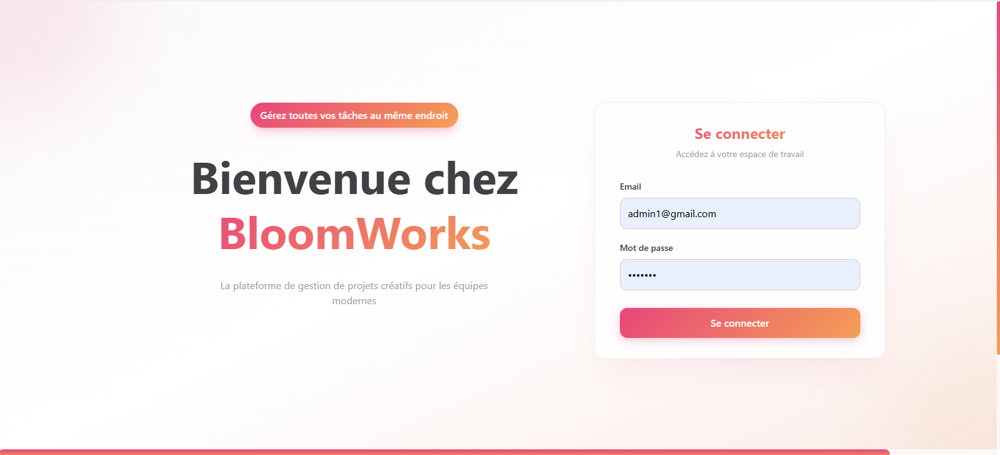
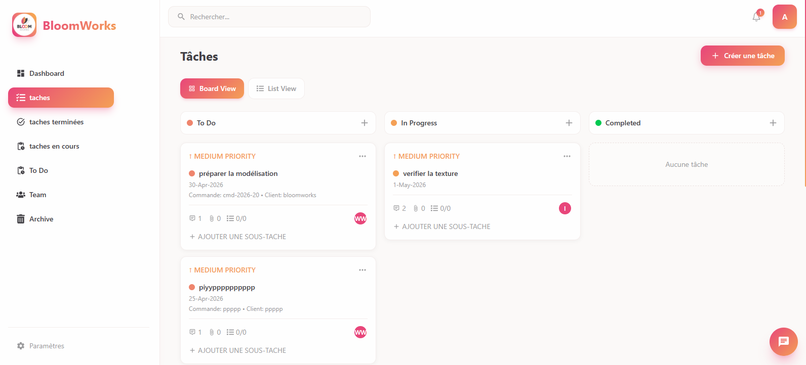
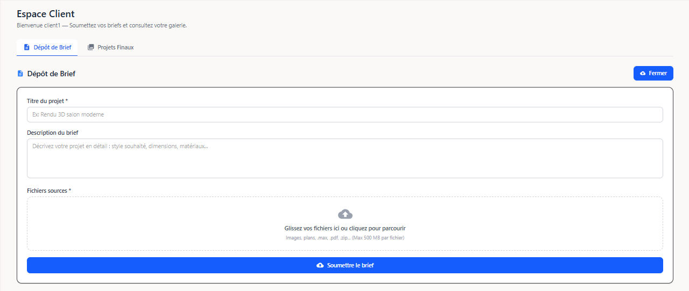
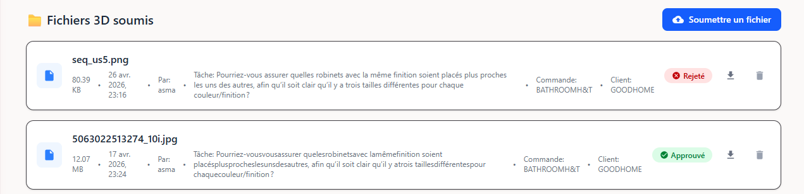
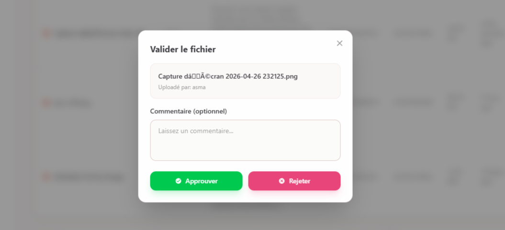
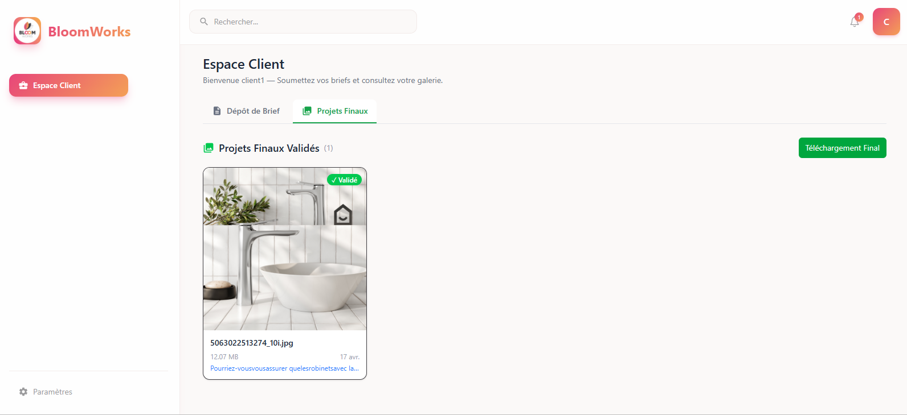
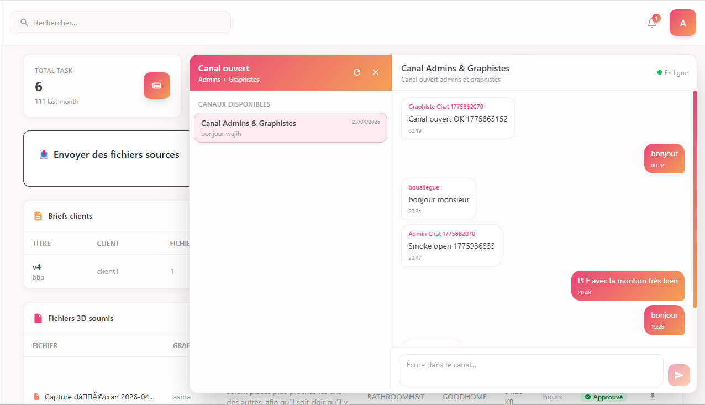

<div align="center">

# 🌸 BloomWorks

### Task & production management platform for 3D graphic design teams

*End-of-studies project (PFE) — Bachelor's in Computer Science, Software Engineering & Information Systems*
*Faculty of Sciences of Bizerte, University of Carthage · Academic year 2025–2026*


**English** · [Français](README.fr.md)

</div>



---

## 📌 Overview

BloomWorks is a full-stack web platform built during a 4-month internship at **Global Rendering**, a company that produces custom **3D models** for sales visuals and interactive tools.

The team used to run its workflow across WhatsApp, Messenger, email and Excel/Google Sheets. Briefs, files, feedback and task status were scattered, hard to trace and hard to secure. BloomWorks replaces that with **one centralized, role-based workspace** covering the whole production flow: client brief → task assignment → 3D production → admin validation → delivery to the client.

## ✨ Features

### 👤 Three roles, three workspaces

| Role | What they can do |
|------|------------------|
| **Admin** | Create / edit / delete user accounts, create and assign tasks, receive client files and forward source files to graphic designers, approve or reject final deliverables (with comments), send progress updates to clients, supervise everything from a dashboard |
| **Graphic designer** | See assigned tasks with deadlines and priority, download source files, update task progress, submit final work, read the admin's validation feedback |
| **Client** | Submit briefs with files (JPG, PNG, PDF, ZIP, MAX…), follow project progress, download validated final deliverables |

### 🔧 Functional highlights

- **Secure authentication**: JWT stored in an HTTP-only cookie, passwords hashed with bcrypt, role-based route protection (`protectRoute` + `isAdminRoute` middlewares)
- **Task management**: Kanban board and list view (To Do / In Progress / Completed), priorities, deadlines, sub-tasks, soft-delete with a **trash/archive** and restore
- **File management**: client uploads up to 500 MB per file, stored on **Cloudinary**, downloaded through **signed URLs**
- **Validation workflow**: the admin approves or rejects each final deliverable with a comment, and approved work is automatically published to the client's space
- **Real-time notifications** via Socket.IO (persisted in MongoDB, so offline users see them on next login)
- **Automatic emails** (SMTP) with the full task details when a task is created, with de-duplicated recipients and per-recipient error handling
- **Internal chat** between admins and designers, with unread counters and read receipts
- **Client portal** with a *Validated Final Projects* gallery

## 🖼️ Screenshots

| Task board (Kanban) | Client portal — brief submission |
|:---:|:---:|
|  |  |

| Review of submitted 3D files | Approve / reject with comment |
|:---:|:---:|
|  |  |

| Validated projects gallery (client) | Real-time internal chat |
|:---:|:---:|
|  |  |

## 🏗️ Architecture

The application follows the **MERN** stack with a REST API, an MVC backend and a real-time layer.


Request flow:

```
React component → Redux Toolkit Query → Vite proxy → Express routes
→ Controllers (MVC) → Mongoose models → MongoDB Atlas → JSON response → Redux store
```

| Layer | Technologies |
|-------|--------------|
| Frontend | React, Vite, Redux Toolkit (RTK Query), Tailwind CSS |
| Backend | Node.js, Express.js (REST API, MVC) |
| Database | MongoDB with Mongoose, hosted on MongoDB Atlas |
| Real time | Socket.IO (JWT-authenticated connections) |
| File storage | Cloudinary (signed download URLs) |
| Email | SMTP service (HTML emails) |
| Security | JWT, bcrypt, HTTP-only cookies, CORS with credentials |
| Tooling | VS Code, Postman, Figma, draw.io |

### Authentication details

| Cookie parameter | Value |
|------------------|-------|
| `httpOnly` | `true`, not accessible from browser JavaScript (mitigates XSS) |
| `sameSite` | `lax` (mitigates CSRF) |
| `secure` | `true` in production (HTTPS only) |
| `maxAge` | 1 day |

The same JWT is verified for WebSocket connections by a Socket.IO middleware before a socket is allowed to connect.

## 📐 Design (UML)

<details>
<summary><b>Global use case diagram</b></summary>
<br>


</details>

<details>
<summary><b>Class diagram</b></summary>
<br>


</details>

## 🔌 API overview

A selection of the main endpoints (all protected routes require the JWT cookie):

| Domain | Method & route | Access |
|--------|----------------|--------|
| Auth | `POST /api/users/login` · `POST /api/users/logout` | Public / authenticated |
| Users | `POST /api/users/register` · `PUT /api/users/profile` · `DELETE /api/users/:id` · `GET /api/users/get-team` | Admin |
| Files | `POST /api/files/upload` · `GET /api/files` · `GET /api/files/:id` | Client / Admin |
| Sources | `POST /api/sources/upload` · `GET /api/sources` · `GET /api/sources/:id/download` | Admin / Designer |
| Tasks | `POST /api/tasks/create` · `GET /api/tasks` · `GET /api/tasks/dashboard` · `PUT /api/tasks/update-stage/:id` · `DELETE /api/tasks/delete-restore/:id?actionType=trash` | Admin / Designer |
| Client | `GET /api/client/gallery` · `PUT /api/client/...` (approve / reject) | Client / Admin |
| Notifications | `DELETE /api/notifications/:id` | Authenticated |
| Chat | `GET/POST /api/chat/conversations` · `GET /api/chat/conversations/:id/messages` · `POST /api/chat/messages` | Admin / Designer |

Every endpoint was tested with **Postman** (success cases, 401 for invalid credentials, 403 for non-admin access, 404 for missing resources…). The test tables are in the full report.

## 🚀 Getting started

### Prerequisites

- Node.js and npm
- A MongoDB database (local or MongoDB Atlas)
- A Cloudinary account
- *(Optional)* An SMTP account, since task emails are skipped if SMTP is not configured

### Installation

```bash
# 1. Clone the repository
git clone https://github.com/bouallegazyz/syst-me-de-gestion-des-projets-pour-des-graphistes.git
cd syst-me-de-gestion-des-projets-pour-des-graphistes

# 2. Install dependencies (adapt folder names to your repo structure)
cd server && npm install
cd ../client && npm install
```

### Environment variables

Create a `.env` file in the backend folder (variable names may differ in your code, so adjust them):

```env
PORT=8800
MONGODB_URI=<your-mongodb-connection-string>
JWT_SECRET=<a-long-random-secret>
NODE_ENV=development

CLOUDINARY_CLOUD_NAME=<your-cloud-name>
CLOUDINARY_API_KEY=<your-api-key>
CLOUDINARY_API_SECRET=<your-api-secret>

# Optional: enables automatic task emails
SMTP_HOST=<smtp-host>
SMTP_PORT=<smtp-port>
SMTP_USER=<smtp-user>
SMTP_PASS=<smtp-password>
```

> ⚠️ Never commit your `.env` file. Make sure it is listed in `.gitignore`.

### Run

```bash
# Backend (API on http://localhost:8800)
cd server && npm run dev

# Frontend (Vite dev server, proxies /api to the backend)
cd client && npm run dev
```

## 🗓️ Project management

The project was delivered with **Scrum** over **16 weeks**: one analysis sprint, then five 3-week sprints, with 24 user stories in the product backlog.

| Sprint | Goal | User stories |
|:------:|------|--------------|
| 1 | Authentication & account management | US20, US21, US22, US11, US12, US13, US8 |
| 2 | Client file management & Cloudinary storage | US1, US14, US3, US19 |
| 3 | Task management | US7, US4, US9, US6, US24 |
| 4 | Validation & production control | US5, US10, US15 |
| 5 | Communication & feedback | US2, US16, US17, US18, US23 |

## 🔮 Possible improvements

- Advanced statistics module
- More robust real-time notifications
- AI integration
- Online payment system

## 📄 Full report

The complete end-of-studies report (in French: requirements analysis, UML diagrams, sequence diagrams, sprint-by-sprint implementation and test tables) is available here: **[`docs/rapport_de_stage.pdf`](docs/rapport_de_stage.pdf)**

## 👨‍💻 Author

**Mohamed Aziz Bouallegue**
Computer science student (Software Engineering & Information Systems), Faculty of Sciences of Bizerte
📍 Ariana, Tunisia · 🔗 [GitHub](https://github.com/bouallegazyz)

*Internship carried out at **Global Rendering**.*
